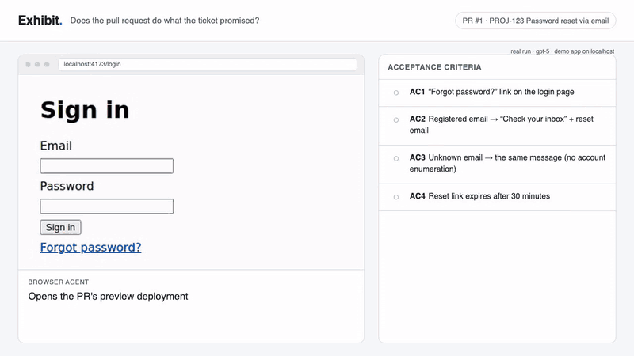

# Exhibit

**Verifies that a pull request does what its ticket promised — with evidence.**



<sub>Animation built from the screenshots and results of a real run on the demo app in this repository.</sub>

AI writes code faster than teams can check it. Code-review bots read the diff and comment on the code,
but nobody answers the question that matters before merging: *does the running app now do what the
ticket asked for?*

Exhibit answers it on every pull request. It reads the ticket and its acceptance criteria, opens the
PR's preview deployment in a real browser, checks each criterion like a tester would, and posts one
comment with a verdict and proof — video, screenshots and a replayable trace.

## Why

Coding agents are starting to write most of the code. Reviewing changes shifts from *"is this line
right?"* to *"is this what we asked for?"* — and that question is still answered by hand, if at all.

Exhibit's goal is simple: **every change arrives with evidence that it does what was asked.** Acceptance
criteria stop being text in a ticket and become checks that run on every pull request. The ones that pass
turn into ordinary tests that stay in your repository. People review intent and evidence instead of
re-clicking through every change.

Exhibit is not a code-style reviewer (other tools do that well), not a framework you write tests in, and
not a replacement for the people who approve a merge — it gives them proof to decide on.

> **Early preview (v0.3).** Works end to end on GitHub; tested so far on a demo app and a real Jira Cloud site. If you'd like to try it
> on your project, open an issue — early users get hands-on help with the setup.

## What you get in the pull request

A real comment from this repository's [self-test](https://github.com/mbukowski-dev/exhibit/pull/1), shortened:

> ### Exhibit · PROJ-123 Password reset via email
> **❌ Acceptance criteria not met** — 1/4 acceptance criteria verified, 1 partly
>
> | | Acceptance criterion | Evidence |
> |---|---|---|
> | ✅ | **AC1** "Forgot password?" link is visible on the login page | Link present; clicking it opens the reset form with an Email field and a "Send reset link" button. |
> | 🟡 | **AC2** A registered email shows "Check your inbox" and sends a reset email | "Check your inbox" shown. *Not verified:* email delivery cannot be checked in a browser. |
> | ❌ | **AC3** An unknown email shows the same message (no account enumeration) | After submitting nobody@example.com the page shows **"No account found for this email"** — it reveals which accounts exist. |
> | ⚠️ | **AC4** The reset link expires after 30 minutes | Needs a human: cannot be verified in a normal browser session. |
>
> ▸ Code review against the ticket · ▸ Scenarios · ▸ 🧪 2 generated Playwright tests
>
> 📎 Videos & traces · $0.10 · 1m 40s

**How to read it:** ✅ verified in the browser · 🟡 the visible part works, the rest can't be checked in a
browser · ❌ the app behaves differently than the ticket says (never given without browser evidence) ·
⚠️ a human needs to look.

## How it works

1. **Reads the ticket** (Jira, or a Markdown file) and extracts the acceptance criteria — also from prose
   or Given/When/Then.
2. **Reviews the diff against the ticket** — which criteria the change implements, what else it could break.
   Not style or naming: other tools do that.
3. **Plans browser scenarios** for every criterion, including edge cases, and marks what a browser can't check.
4. **Runs them with a browser agent** on your preview deployment: it reads the page's accessibility tree,
   clicks and types, and must *see* the expected result before it may report ✅.
5. **Turns passing scenarios into plain Playwright tests**, replayed once without AI, that you can commit —
   next time no AI is needed, and there's no lock-in.

## Set it up on a repository (about 15 minutes)

**You need:** a web app on GitHub with a **preview deployment per pull request** (Vercel, Netlify or your
own), tickets with acceptance criteria in **Jira**, and an **OpenAI or Anthropic API key**.

Add `.github/workflows/exhibit.yml` — full example and options in **[docs/github-action.md](docs/github-action.md)**:

```yaml
on: pull_request
permissions: { contents: read, pull-requests: write, statuses: write }
concurrency: { group: "exhibit-${{ github.event.pull_request.number }}", cancel-in-progress: true }  # one paid run per PR, not per push
jobs:
  exhibit:
    runs-on: ubuntu-latest
    timeout-minutes: 30
    steps:
      - uses: actions/checkout@3d3c42e5aac5ba805825da76410c181273ba90b1  # v7.0.1
      - uses: mbukowski-dev/exhibit@9c32faf06d94f54974d61c0495a4a6b3f2a38a69  # v0.3.3
        with:
          preview-url: https://myapp-git-{branch}-acme.vercel.app
          openai-api-key: ${{ secrets.OPENAI_API_KEY }}
          jira-base-url: https://acme.atlassian.net
          jira-email: ${{ secrets.JIRA_EMAIL }}
          jira-api-token: ${{ secrets.JIRA_API_TOKEN }}
```

Name the branch or PR title after the ticket (`feature/PROJ-123-…` or `PROJ-123: …`) and open a pull
request. By default Exhibit only comments; `mode: check` can block merging once you trust it.

**Cost and time:** you pay your model provider directly. On the demo app a run takes about 2 minutes and
costs about $0.10 with `gpt-5`; real apps with more criteria cost more. Every run has a hard cap
(`max_cost_per_run_usd`, default $1.50).

## Configuration (`.exhibit.yml`, optional)

```yaml
preview_url: "https://pr-{pr}.myapp.vercel.app"   # {pr}, {branch}, {sha} are filled in
model:
  provider: openai                 # openai | anthropic — picked automatically from the key you set
  max_cost_per_run_usd: 1.5
mode: comment                      # comment (advisory) | check (fails the status on ❌)
max_scenarios: 8
agent_notes: |                     # your test environment: accounts, seed data, what not to touch
  Registered test account: ana@example.com
auth:                              # if the app needs a login
  - role: user
    username_env: EXHIBIT_USERNAME # values come from GitHub secrets
    password_env: EXHIBIT_PASSWORD
    login_flow: ./e2e/login.ts     # optional: your own login script
allowed_origins: []                # other sites the browser may open, e.g. an SSO login page
```

## Try it locally

Requires Node.js 22+ and pnpm.

```bash
git clone https://github.com/mbukowski-dev/exhibit && cd exhibit
pnpm install && pnpm --filter @exhibit/core exec playwright install chromium
cp .env.example .env                       # add OPENAI_API_KEY or ANTHROPIC_API_KEY

node examples/demo-app/server.mjs &        # demo app with a deliberate bug, http://localhost:4173
pnpm exhibit verify --ticket-file examples/PROJ-123.md --url http://localhost:4173 --headed -v
```

Other commands: `exhibit context` (what Exhibit would verify, no AI), `exhibit plan` (review and plan,
no browser). Evidence and run diagnostics are written to `exhibit-artifacts/`.

## Security and responsible use

The agent really clicks and submits forms: **run Exhibit only against preview or staging environments
with test data.** It never sends credentials to the model, never leaves your app's origin, and you pin the
action to a commit SHA so you only run code you chose. Details, what is sent to your model provider, and
how to report a vulnerability: **[SECURITY.md](SECURITY.md)**.

## Status

Early preview. What works and what's next: [ROADMAP.md](ROADMAP.md) · Changes: [CHANGELOG.md](CHANGELOG.md).

## License and pricing

Exhibit is **source-available** under the [Business Source License 1.1](LICENSE): the code is public so you
can read, audit and modify everything that runs with your secrets.

| | |
|---|---|
| **Free** | personal, non-commercial and educational use · repositories of open source projects · **one private repository per organization** (up to 10 contributors) · evaluation and testing, always |
| **Commercial license** | an organization using Exhibit on more than one private repository, or on a private repository with more than 10 contributors — [get in touch](https://github.com/mbukowski-dev/exhibit/issues) |

Each version becomes open source under Apache 2.0 four years after it is published. The license text is
what counts; this table is a summary.
